<div align="center">


<br/>

**A keyboard-driven terminal music player. Browse and search the Jamendo catalogue, then stream it through a headless VLC, without leaving your shell.**

<br/>


[Features](#-features) ·
[Screenshots](#-screenshots) ·
[Quick start](#-quick-start) ·
[Controls](#%EF%B8%8F-keyboard-controls) ·
[Architecture](#%EF%B8%8F-architecture) ·
[Testing](#-testing) ·
[Roadmap](#%EF%B8%8F-roadmap--known-limitations)

<br/>

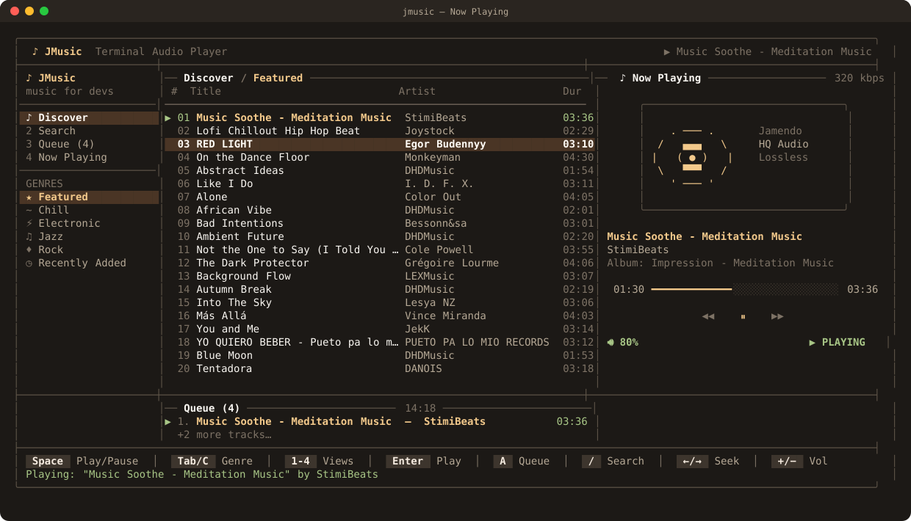

<sub>Real frame rendered by JMusic's own renderer with live data from the Jamendo API.</sub>

</div>

---

## 📑 Table of contents

- [Why JMusic](#-why-jmusic)
- [Features](#-features)
- [Screenshots](#-screenshots)
- [Quick start](#-quick-start)
- [Configuration](#%EF%B8%8F-configuration)
- [Keyboard controls](#%EF%B8%8F-keyboard-controls)
- [Architecture](#%EF%B8%8F-architecture)
  - [System context](#system-context)
  - [Layers](#layers)
  - [The render loop](#the-render-loop)
  - [Playing a track](#playing-a-track)
  - [Discover caching and the race guard](#discover-caching-and-the-race-guard)
  - [Playback state machine](#playback-state-machine)
  - [Talking to VLC](#talking-to-vlc)
  - [Rendering without a TUI framework](#rendering-without-a-tui-framework)
- [Design decisions](#-design-decisions)
- [Project structure](#-project-structure)
- [Error handling](#%EF%B8%8F-error-handling)
- [Testing](#-testing)
- [Troubleshooting](#-troubleshooting)
- [Roadmap & known limitations](#%EF%B8%8F-roadmap--known-limitations)
- [Contributing](#-contributing)
- [Credits & license](#-credits--license)

---

## 💡 Why JMusic

Most terminal music players play local files. JMusic plays **nothing from your disk**. It treats [Jamendo](https://www.jamendo.com), a large catalogue of independent Creative Commons music, as its library and [VLC](https://www.videolan.org/vlc/) as its audio engine. JMusic itself is the thin, fast coordinator in between.

> **Jamendo provides the music data and audio URL. VLC plays the audio. JMusic coordinates them and provides the terminal interface.**

- **Zero setup library.** No folders to import, no tags to fix. Open it and press `Enter`.
- **One runtime dependency.** `dotenv`. The terminal UI, layout engine, and VLC bridge are hand-written TypeScript.
- **Stays out of your way.** Full-screen alternate buffer, every action on one key, and your terminal comes back exactly as you left it.

---

## ✨ Features

<table>
<tr>
<td width="50%" valign="top">

### 🎧 Discover
- Six curated feeds: **Featured**, **Chill**, **Electronic**, **Jazz**, **Rock**, **Recently Added**
- Featured loads automatically on launch
- **Per-genre in-memory cache**: revisiting a genre is instant, no network call
- **Cursor memory**: each genre remembers which track you were on
- **Race-safe**: flicking through genres faster than the network can never show the wrong list

</td>
<td width="50%" valign="top">

### 🔍 Search
- Free-text search over titles and artists (`/`, type, `Enter`)
- HTML entities from the API (`&amp;`, `&#039;`) decoded for clean titles
- Tracks without a playable stream are filtered out before they reach you
- Clear empty, loading, and error states

</td>
</tr>
<tr>
<td valign="top">

### ▶️ Playback
- Play, pause/resume, stop
- Seek ±5 s, clamped to the track bounds
- Volume ±5 % and mute that remembers your level
- Live progress bar polled from VLC every 500 ms. **VLC is the source of truth**, the UI never guesses
- Explicit states: `stopped` · `buffering` · `playing` · `paused` · `error`

</td>
<td valign="top">

### 📜 Queue
- Add any track with `A` without interrupting playback
- Next / previous with `N` / `P`
- **Auto-advance** to the next track when a song ends
- Dedicated queue view: play from any position, remove with `D`
- Compact queue strip under the main list on tall terminals

</td>
</tr>
<tr>
<td valign="top">

### 🖥️ Interface
- Responsive **3-column layout** (sidebar · list · Now Playing) at ≥ 80 columns
- Graceful **single-column** fallback on narrow terminals
- Redraws on resize; friendly message below 40×10
- 24-bit warm-beige theme, rounded borders, key-hint badges that fit the width

</td>
<td valign="top">

### 🛡️ Reliability
- Pre-flight checks for the API key and VLC, with install hints per OS
- Finds VLC automatically on macOS, Linux, and Windows (or use `VLC_PATH`)
- 10 s timeout on every API call, typed errors with codes
- Terminal restored on `Q`, `Ctrl+C`, `SIGTERM`, or an unexpected crash; VLC shut down with it

</td>
</tr>
</table>

---

## 📸 Screenshots

Every image below is a real frame produced by JMusic's renderer (`AppView.render`) using live Jamendo data, converted from ANSI to SVG.

<table>
<tr>
<td width="50%">
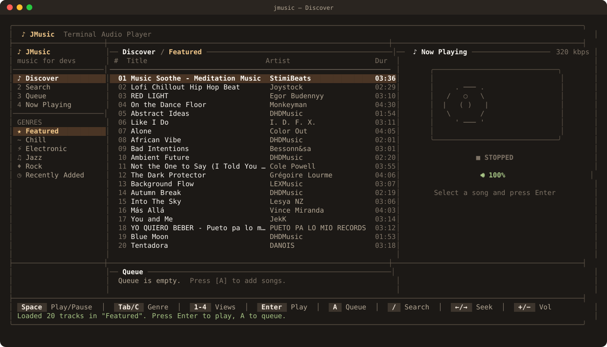
<p align="center"><b>Discover</b>: Featured feed on launch, nothing playing yet</p>
</td>
<td width="50%">
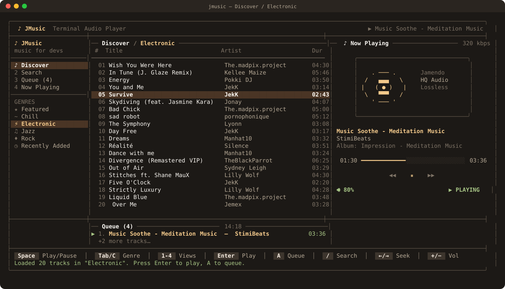
<p align="center"><b>Genres</b>: <code>Tab</code> cycles feeds; the sidebar tracks the active one</p>
</td>
</tr>
<tr>
<td>
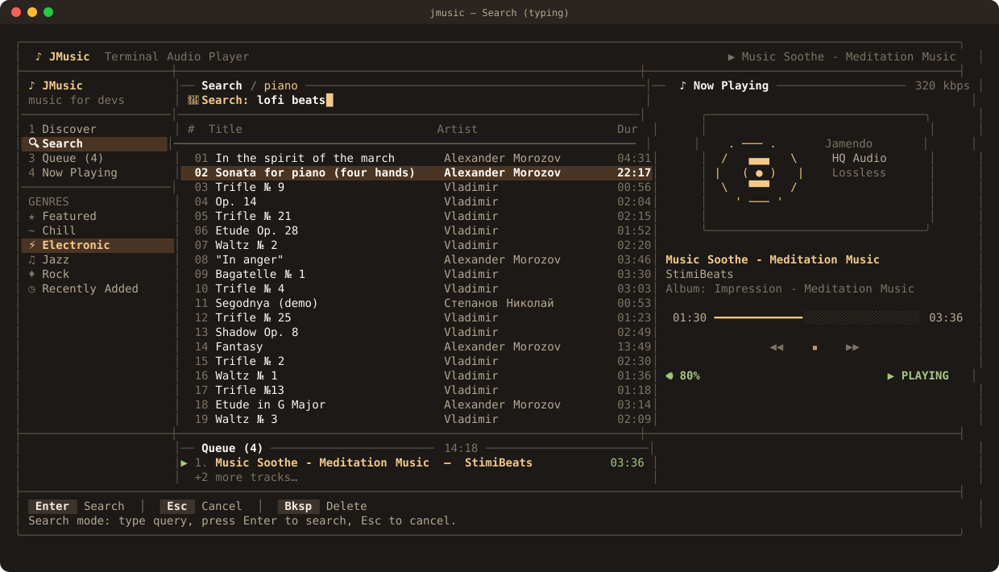
<p align="center"><b>Search input</b>: <code>/</code> opens the prompt, footer switches to search hints</p>
</td>
<td>
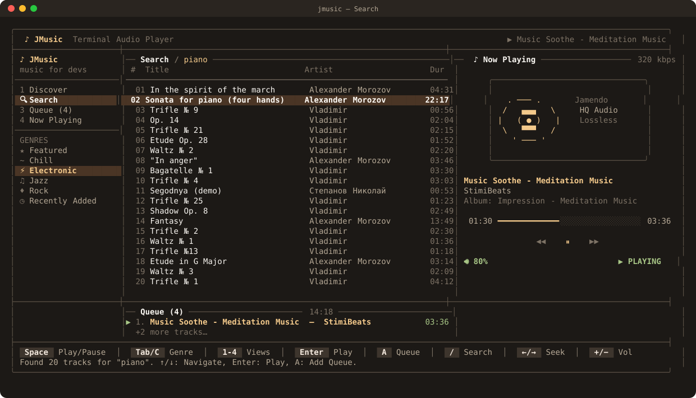
<p align="center"><b>Search results</b>: column-aligned, selection highlighted</p>
</td>
</tr>
<tr>
<td>
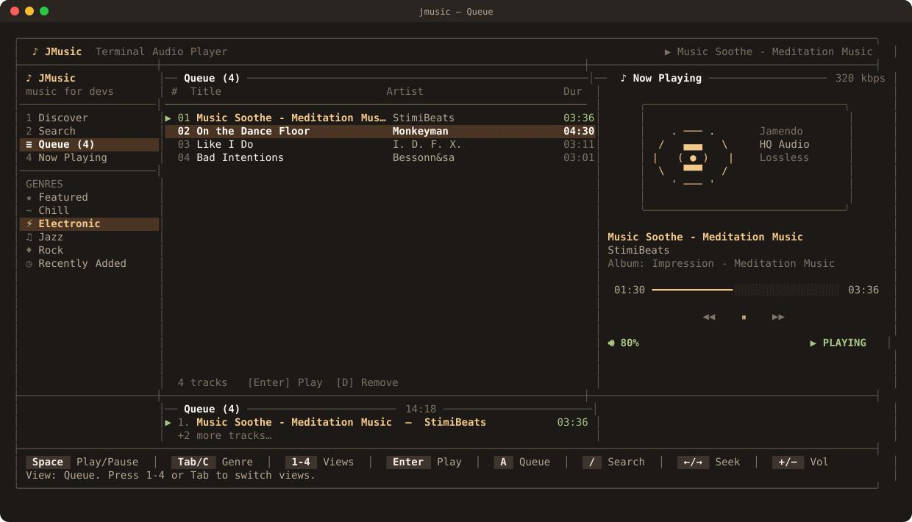
<p align="center"><b>Queue</b>: current track marked ▶, <code>Enter</code> to jump, <code>D</code> to remove</p>
</td>
<td align="center">
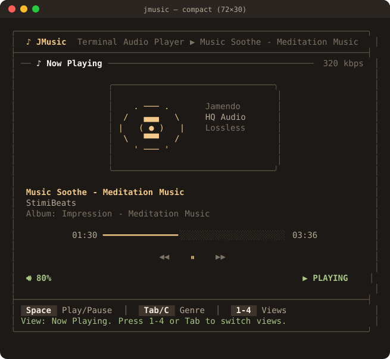
<p align="center"><b>Compact mode</b>: below 80 columns the layout collapses to one panel</p>
</td>
</tr>
</table>

---

## 🚀 Quick start

### Prerequisites

| Requirement | Version | Install |
|---|---|---|
| **Node.js** | 20 or newer (native `fetch`, `node:test`) | [nodejs.org](https://nodejs.org) |
| **VLC** | any recent 3.x | macOS `brew install --cask vlc` · Debian/Ubuntu `sudo apt install vlc` · Arch `sudo pacman -S vlc` · Windows [videolan.org](https://www.videolan.org/vlc/) |
| **Jamendo Client ID** | free | [developer.jamendo.com](https://developer.jamendo.com/v3.0/authentication) |
| **Terminal** | true-colour recommended | iTerm2, Ghostty, Kitty, Alacritty, WezTerm, Windows Terminal, macOS Terminal |

### Install and run

```bash
git clone https://github.com/rajdeep-2004/jmusic.git
cd jmusic
npm install

cp .env.example .env          # then set JAMENDO_CLIENT_ID in .env

npm run build                 # compile TypeScript → dist/
npm start                     # launch the player
```

### Install as a global command

```bash
npm run build && npm link
jmusic
```

### Scripts

| Script | What it does |
|---|---|
| `npm run build` | Compile `src/` and `tests/` with `tsc` into `dist/` |
| `npm start` | Run `dist/src/index.js` |
| `npm run dev` | `tsc --watch`: recompile on save (restart `npm start` to pick up changes) |
| `npm test` | Build, then run every suite with Node's built-in test runner |

---

## ⚙️ Configuration

All configuration comes from environment variables, loaded from `.env` by `dotenv`. `.env` is git-ignored; `.env.example` is the template.

| Variable | Required | Default | Purpose |
|---|:---:|---|---|
| `JAMENDO_CLIENT_ID` | ✅ | — | Authenticates every Jamendo request |
| `VLC_PATH` | | auto-detected | Absolute path to the VLC binary if it is not in a standard location |
| `SEEK_SECONDS` | | `5` | Seek step for `←` / `→` |
| `VOLUME_STEP` | | `5` | Volume step (percent) for `+` / `-` |
| `JAMENDO_CLIENT_SECRET` | | — | Not used yet; reserved for future OAuth features (playlists, favourites) |

<details>
<summary><b>Where JMusic looks for VLC</b></summary>

1. `VLC_PATH`, if set
2. Platform defaults
   - **macOS**: `/Applications/VLC.app/Contents/MacOS/VLC`, `~/Applications/VLC.app/…`, `/opt/homebrew/bin/vlc`, `/usr/local/bin/vlc`
   - **Linux**: `/usr/bin/vlc`, `/usr/local/bin/vlc`, `/snap/bin/vlc`, `/usr/bin/cvlc`
   - **Windows**: `C:\Program Files\VideoLAN\VLC\vlc.exe`, `C:\Program Files (x86)\VideoLAN\VLC\vlc.exe`
3. `which vlc || which cvlc` (or `where vlc` on Windows)

</details>

---

## ⌨️ Keyboard controls

<table>
<tr><th>Navigation</th><th>Playback</th></tr>
<tr>
<td valign="top">

| Key | Action |
|---|---|
| <kbd>1</kbd> <kbd>2</kbd> <kbd>3</kbd> <kbd>4</kbd> | Discover · Search · Queue · Now Playing |
| <kbd>Tab</kbd> | Next genre (Discover) / next view |
| <kbd>Shift</kbd>+<kbd>Tab</kbd> | Previous genre (Discover) / back to Discover |
| <kbd>C</kbd> <kbd>]</kbd> · <kbd>[</kbd> | Next · previous genre |
| <kbd>↑</kbd> <kbd>↓</kbd> or <kbd>k</kbd> <kbd>j</kbd> | Move selection |
| <kbd>/</kbd> | Start a search |
| <kbd>Esc</kbd> | Cancel search input |
| <kbd>Q</kbd> · <kbd>Ctrl</kbd>+<kbd>C</kbd> | Quit and restore the terminal |

</td>
<td valign="top">

| Key | Action |
|---|---|
| <kbd>Enter</kbd> | Play selected track |
| <kbd>Space</kbd> | Play / pause |
| <kbd>S</kbd> | Stop |
| <kbd>N</kbd> · <kbd>P</kbd> | Next · previous in queue |
| <kbd>←</kbd> · <kbd>→</kbd> | Seek −5 s · +5 s |
| <kbd>+</kbd> · <kbd>-</kbd> | Volume up · down |
| <kbd>M</kbd> | Mute / unmute |
| <kbd>A</kbd> | Add selected track to queue |
| <kbd>D</kbd> / <kbd>X</kbd> | Remove from queue (Queue view) |

</td>
</tr>
</table>

---

## 🏗️ Architecture

### System context

JMusic never touches audio bytes. It fetches metadata and a stream URL from Jamendo, then hands the URL to a VLC child process that streams and plays it.

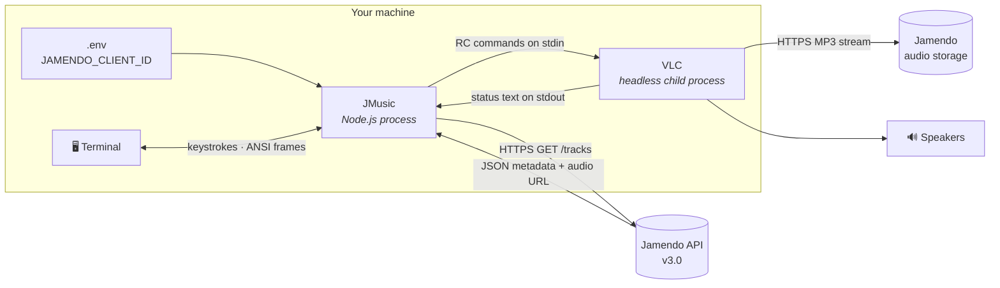

### Layers

Dependencies point one way: **TUI → App → services → external systems**. The UI never calls Jamendo or VLC, the Jamendo client never plays audio, the VLC adapter knows nothing about the queue, and the queue has no I/O at all.

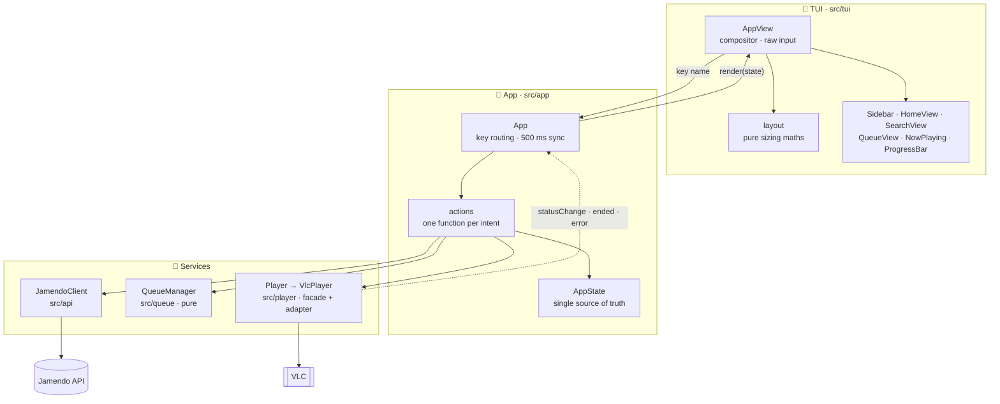

| Layer | Responsibility | Must not |
|---|---|---|
| `tui/` | Turn `AppState` into strings; decode raw key bytes | Call Jamendo, VLC, or the queue |
| `app/` | Own state, route keys, run actions, coordinate services | Contain rendering or protocol details |
| `api/` | HTTP, query params, errors, normalise to `Track` | Render, play, or manage the queue |
| `player/` | Spawn and drive VLC behind the `IPlayer` interface | Know about the queue or the UI |
| `queue/` | Ordering, current index, next/previous, shuffle, repeat | Do any I/O |

### The render loop

JMusic follows a unidirectional data flow, the same idea as Redux or the Elm Architecture, without a framework: **state → render → key → action → state**.

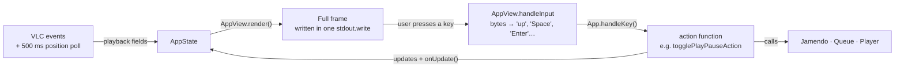

Actions receive their dependencies (`player`, `client`, `queueManager`) as arguments. That makes them trivially testable with fakes, with no mocking library.

### Playing a track

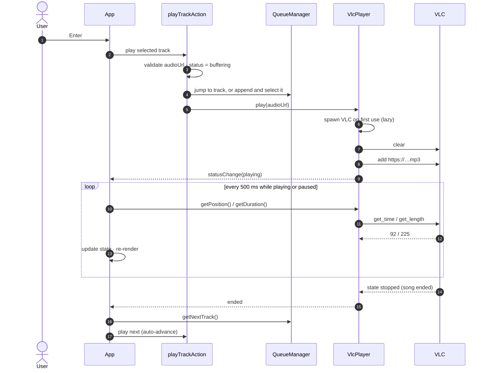

### Discover caching and the race guard

Each genre's tracks are cached in memory after the first fetch, and the cursor position is remembered per genre. A response is only shown if the user is **still on that genre** when it arrives, so a slow, stale response can never overwrite what is on screen.

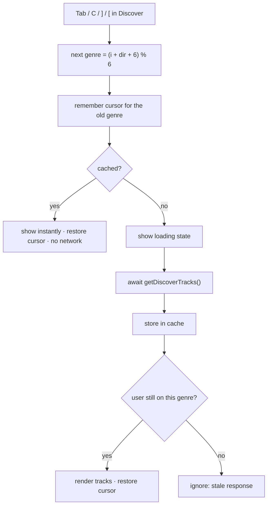

### Playback state machine

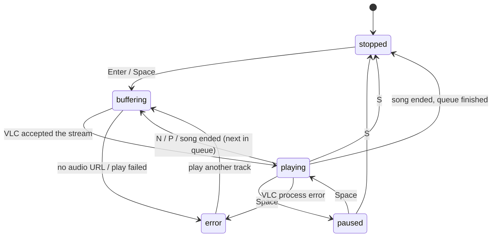

### Talking to VLC

VLC runs headless with its **Remote Control (RC)** interface:

```bash
vlc -I rc --rc-fake-tty --no-video --no-media-library --quiet
```

JMusic writes plain-text commands to VLC's stdin and parses replies from stdout.

| `IPlayer` method | RC command | Notes |
|---|---|---|
| `play(url)` | `clear` → `add <url>` | Replaces whatever was playing |
| `pause()` / `resume()` | `pause` | VLC toggles |
| `stop()` | `stop` | |
| `seek(s)` | `seek <s>` | Absolute seconds |
| `getPosition()` | `get_time` | 1 s reply timeout → 0 |
| `getDuration()` | `get_length` | 1 s reply timeout → 0 |
| `setVolume(p)` | `volume <0–256>` | VLC's scale: 256 = 100 % |
| `destroy()` | `quit` | `SIGTERM` after 200 ms if still alive |

Everything VLC-specific lives in `src/player/VlcPlayer.ts`. Swapping in another engine (mpv, for example) means writing one class that implements `IPlayer` and passing it to `new Player(...)`.

### Rendering without a TUI framework

The interface is drawn directly with ANSI escape sequences. No blessed, no Ink.

| Technique | Sequence / API |
|---|---|
| Alternate screen (restores your scrollback on exit) | `ESC[?1049h` / `ESC[?1049l` |
| Hide / show cursor | `ESC[?25l` / `ESC[?25h` |
| Flicker-free frames: cursor home, overwrite | `ESC[H` + one `stdout.write` per frame |
| 24-bit colour | `ESC[38;2;R;G;Bm`, `ESC[48;2;R;G;Bm` |
| Unbuffered keys, own `Ctrl+C` handling | `process.stdin.setRawMode(true)` |
| Arrow keys and Shift+Tab | decoded from `ESC[A`…`ESC[D`, `ESC[Z` |
| Responsive sizing | `stdout.columns` / `rows` + `resize` event |

Each panel renders to an array of fixed-width lines. `layout.ts` (pure, unit-tested) decides the widths, and `AppView` zips the panels together with box-drawing borders. `stripAnsi` / `padEndAnsi` measure visible width so colour codes do not break alignment.

| Terminal width | Sidebar | Now Playing | Layout |
|---|---|---|---|
| < 80 | — | — | single column |
| 80–99 | 18 | 28 | three columns |
| 100–129 | 20 | 36 | three columns |
| 130–159 | 20–22 | 46 | three columns |
| ≥ 160 | 22 | ~32 % (48–62) | three columns |

The queue strip appears when the terminal has at least 27 rows.

---

## 🧭 Design decisions

<details>
<summary><b>Why no TUI framework?</b></summary>

The UI needs coloured text, boxes, and keys. Raw ANSI covers that in a few hundred lines, keeps the runtime dependency count at one, and gives full control over layout. The trade-off is that features libraries provide (diff-based redraws, Unicode width tables, robust escape-sequence parsing) are either hand-written or not yet implemented. See [known limitations](#%EF%B8%8F-roadmap--known-limitations).
</details>

<details>
<summary><b>Why VLC over RC instead of a native audio library?</b></summary>

Decoding and output in Node needs native modules that differ per OS. VLC already handles every format and HTTPS streaming on every platform. The RC interface needs no bindings, just a child process and pipes.
</details>

<details>
<summary><b>Why poll VLC every 500 ms?</b></summary>

The RC interface does not push position updates. Polling `get_time` and `get_length` keeps VLC as the single source of truth for playback position. Polling only runs while a track is playing or paused.
</details>

<details>
<summary><b>Why Node's built-in test runner?</b></summary>

`node:test` and `node:assert/strict` ship with Node 20: zero test dependencies, no config, fast. Business logic is written as pure functions and injectable actions, so fakes are plain objects.
</details>

<details>
<summary><b>Why normalise Jamendo responses?</b></summary>

`normalizeJamendoTrack` maps raw fields (`name`, `artist_name`, `audio`) to the app's own `Track` model. Only `src/api/` knows Jamendo's shape, so an API change is a one-file fix.
</details>

---

## 📁 Project structure

```text
jmusic/
├── src/
│   ├── index.ts              # Entry: pre-flight checks → new App().start()
│   ├── config/config.ts      # Env vars, defaults, validation
│   ├── api/
│   │   ├── types.ts          # Track model, raw Jamendo types, DISCOVER_CATEGORIES
│   │   └── jamendo.ts        # JamendoClient: search, discover, normalisation
│   ├── app/
│   │   ├── state.ts          # AppState + createInitialState()
│   │   ├── App.ts            # Coordinator: key routing, player events, sync timer
│   │   └── actions.ts        # One function per user intent
│   ├── player/
│   │   ├── types.ts          # IPlayer contract
│   │   ├── Player.ts         # Facade over an IPlayer
│   │   └── VlcPlayer.ts      # VLC RC adapter + binary discovery
│   ├── queue/QueueManager.ts # Pure queue logic (next/prev, shuffle, repeat)
│   ├── tui/
│   │   ├── AppView.ts        # Alternate screen, raw input, frame compositor
│   │   ├── layout.ts         # Responsive dimensions (pure)
│   │   ├── colors.ts         # Theme, box characters, ANSI helpers
│   │   ├── Sidebar.ts        # Navigation + genre list
│   │   ├── HomeView.ts       # Discover list
│   │   ├── SearchView.ts     # Search prompt + results
│   │   ├── QueueView.ts      # Queue view + compact strip
│   │   ├── NowPlaying.ts     # Now Playing card, progress, transport, volume
│   │   ├── ProgressBar.ts    # 01:32 ━━━━░░░ 03:45
│   │   └── Logo.ts           # ASCII logo
│   └── utils/
│       ├── formatTime.ts     # seconds → MM:SS / HH:MM:SS
│       └── errors.ts         # JamendoApiError, VlcUnavailableError, VlcPlaybackError
├── tests/                    # node:test suites (58 tests)
├── assets/                   # README banner + screenshots
├── buildPlan.md              # Original scope and architecture plan
├── .env.example
├── package.json
└── tsconfig.json
```

---

## 🛡️ Error handling

Failures become messages in the status bar, not crashes.

| Situation | Behaviour |
|---|---|
| `JAMENDO_CLIENT_ID` missing | Exits before the UI starts, with a sample `.env` |
| VLC not installed | Exits with install commands for macOS, Linux, Windows |
| Jamendo slower than 10 s | `TIMEOUT` error shown in the status bar |
| Offline / DNS failure | `NETWORK_ERROR` shown |
| Bad key / HTTP error / API failure | HTTP status or Jamendo's own `error_message` shown |
| Malformed JSON | `PARSE_ERROR` shown |
| No results | Empty-state message |
| Track with no stream | Filtered out; re-checked before playing |
| VLC process error | Status → `error`, message shown |
| Seek / next / remove with nothing to act on | Explanatory message, no-op |
| Terminal smaller than 40×10 | "Window too small" screen until resized |
| Uncaught exception | Terminal restored, error printed, exit code 1 |

---

## 🧪 Testing

```bash
npm test
```

```text
# tests 58
# suites 10
# pass 58
# fail 0
```

| Suite | Covers |
|---|---|
| `actions.test.ts` | Selection, volume clamping, mute/unmute, seek bounds, play/pause |
| `discover.test.ts` | Genre loading, caching, cursor memory per genre |
| `navigation.test.ts` | View switching and cycling, per-view play and enqueue |
| `queue.test.ts` | Add, next/previous, repeat wrap, remove, shuffle integrity |
| `layout.test.ts` | Breakpoints, row budget, queue strip trigger, narrow fallback |
| `progressBar.test.ts` | Ratio maths, zero-duration guard, clamping |
| `formatTime.test.ts` | `MM:SS`, `HH:MM:SS`, zero, negative, NaN |
| `jamendo.test.ts` | Normalisation, entity decoding, missing-key error, empty query |
| `nowPlaying.test.ts` | Standby card vs active track |
| `logo.test.ts` | Full logo vs compact fallback |

Not yet covered: the `VlcPlayer` process adapter, `App.handleKey` routing, and end-to-end runs against real VLC and Jamendo.

---

## 🩺 Troubleshooting

| Symptom | Fix |
|---|---|
| `[Startup Error] JAMENDO_CLIENT_ID …` | Create `.env` from `.env.example` and set your Client ID |
| `[Startup Error] VLC media player was not found` | Install VLC, or set `VLC_PATH` to the binary |
| Colours look wrong or washed out | Use a true-colour terminal (iTerm2, Ghostty, Kitty, WezTerm, Windows Terminal) |
| A row looks one column off | Some terminals draw emoji (🔊, 🔍) two columns wide; see limitations |
| Search or Discover shows 0 tracks | Jamendo occasionally returns empty pages; switch genre or search again |
| No sound but status says PLAYING | Check system output device and VLC volume; try `vlc <url>` directly |
| Terminal left in a strange state after a hard kill | Run `reset` |

---

## 🗺️ Roadmap & known limitations

**Planned**

- [ ] Key bindings for shuffle and repeat (already implemented in `QueueManager`)
- [ ] Pagination ("load more") for search and genres
- [ ] Queue persistence between sessions
- [ ] Replace RC text parsing with VLC's HTTP/JSON interface
- [ ] Diff-based redraws and Unicode-aware width measurement
- [ ] Integration tests for `VlcPlayer` and key routing

**Known limitations**

- VLC replies are matched to queries first-in-first-out; a status line arriving at the same moment can be read as a position.
- End-of-track detection relies on VLC's text output, which varies between VLC versions.
- Emoji and wide CJK characters are measured as one column, so some rows can be off by one.
- A lone `ESC` byte is treated as the Escape key; a split arrow-key sequence could be misread.
- The bitrate / "Lossless" labels on the Now Playing card are decorative; streams are MP3 (`audioformat=mp32`).
- In the wide layout, view `4` keeps the Discover list in the centre column; the dedicated Now Playing screen is shown in compact mode.
- No retry or backoff on API failures (timeouts only).

---

## 🤝 Contributing

1. Fork and create a branch: `git checkout -b feat/short-description`
2. Keep the layer rules above: no Jamendo or VLC calls from `tui/`, no I/O in `queue/`
3. Add or update tests, then run `npm test`
4. Use [Conventional Commits](https://www.conventionalcommits.org/): `feat(queue): add shuffle key binding`
5. Open a pull request describing what changed and why

---

## 📜 Credits & license

- Music and metadata by **[Jamendo](https://www.jamendo.com)**. Tracks are published by their artists under Creative Commons licences; check each track's licence before reusing it outside personal listening.
- Playback by **[VLC media player](https://www.videolan.org/vlc/)** from VideoLAN.
- Built with TypeScript and Node.js as a capstone project for an Application Development course.

Released under the **ISC License**.

<div align="center">
<br/>
<sub>♪ Made for people who never leave the terminal.</sub>
</div>
